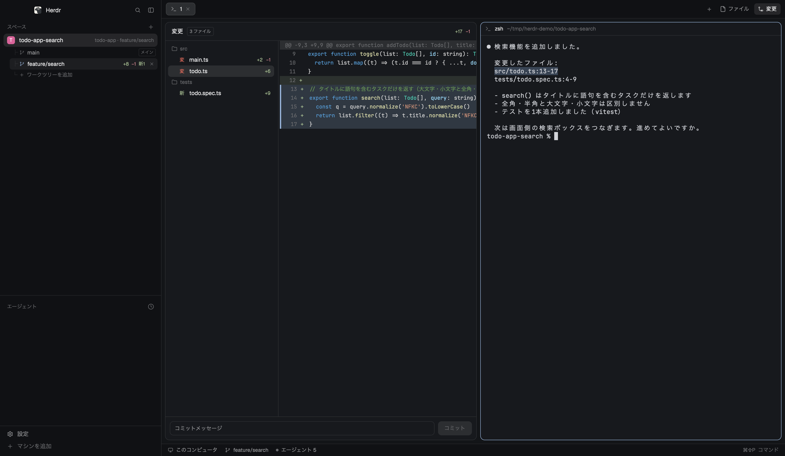

# herdr-ja

[English](README.md) | 日本語

[herdr-app](https://herdr.dev) の日本語レイアウトです。git の worktree を使った作業向けに作りました。
- ラベル、メニュー、ダイアログ、通知はすべて日本語です。
- スペースの下に、そのリポジトリの worktree が並びます。
- worktree を押すと、変更ファイルとコードがメインの表示になり、エージェントのターミナルは右に寄ります。
- ターミナル上で `パス:行番号` を選ぶと、コード表示がその行へ移動します。



## 中身

- `layouts/ja.json`：レイアウト本体です。同梱の `main` を複製して作りました。元の右パネルに加えて、ターミナルの左に開く `wt-panel` 列（ファイル / 変更）があります。
- `mods/`：`ja-*` の mod が17個あります。どれも同梱の mod を複製したものです。
  - `ja-spaces`：スペース一覧です。選択中のスペースの下に worktree を並べます。各行には次のものを表示します。worktree を押すと、ファイル / 変更を広く表示します。
    - ブランチ名
    - メインのバッジ
    - 未コミットの `+追加 −削除 新N`
    - 削除用の `×`
    - 「ワークツリーを追加」
  - `ja-changes`：未コミットの変更一覧です。フォルダ名の見出しの下にファイル名を並べます。差分は色分けして表示し、行番号を左に固定したまま横にスクロールできます。指定された行の範囲は強調します。
  - `ja-files`：ファイルツリーです。ファイルごとに `+追加 −削除` を表示します。上の検索欄では、ファイル名（あいまい検索）と内容（ripgrep）を切り替えられます。Aa / ab / .* で、大文字小文字の区別、単語単位、正規表現を切り替えます。
  - `ja-worktree`：worktree の作成 / 選択ダイアログです。worktree は今のスペースのタブとして開きます。worktree を削除するときは、その中で動いているタブだけを閉じます。
  - `ja-tabs`：タブバーです。右上のファイル / 変更ボタンは、worktree 表示が開いているときはそちらを切り替えます。
  - `ja-agents`、`ja-pane`、`ja-workspace-chrome`、`ja-workspace-status`、`ja-menu`、`ja-new-menu`、`ja-picker`、`ja-help`、`ja-machine-add`、`ja-toast`：同梱の mod を日本語にしたものです。
  - `ja-prompt`、`ja-confirm`：名前変更と閉じる確認のダイアログです。`ja-menu` と `ja-tabs` から呼び出します。
- `keys.json`：`ja` レイアウトでだけ有効なショートカットです。

  | キー | 動作 |
  | --- | --- |
  | F2 | タブ名を変更 |
  | Shift+F2 | スペース名を変更 |
  | `cmd-w` | タブを閉じる |
  | `cmd-p` | ピッカーを開く |
  | `cmd-/` | ヘルプを開く |

## 必要なもの

- herdr-app 0.1.16。`ja-*` の mod はこの版の同梱 mod を複製したものです。新しい herdr-app では、本体側の変更を取り込む必要があるかもしれません。
- ファイル検索に [ripgrep](https://github.com/BurntSushi/ripgrep) を使います（`brew install ripgrep`）。入っていない場合、ファイル名検索は `git ls-files` で代わりに動きますが、内容検索は使えません。
- `git`。

## インストール

コーディングエージェントに次のように頼んでください。

```text
Read ~/.config/herdr-app/AGENTS.md, then add this layout: https://github.com/shimaMatz/herdr-ja
```

エージェントは次の手順でインストールします。

1. `layouts/ja.json` と `mods/ja-*` を `~/.config/herdr-app/` にコピーする
2. `keys.json` を今の設定に追加する
3. mod を1つずつチェックする
4. `ja` レイアウトに切り替える

元のレイアウトには `ctrl-shift-l` で戻せます。

## 使い方

- **worktree を開く**：スペースの下にある worktree の行を押します。ファイル表示がメインになり、ターミナルは右に移ります。右上のファイル / 変更ボタンで表示を切り替えられます。スペースの行を押すと、通常の表示に戻ります。
- **コードへ移動する**：ターミナル上で `src/todo.ts:13-17` のような参照をダブルクリックかドラッグで選びます。エージェントの返答の中でもかまいません。`パス:行番号` やパスだけでも動きます。
  - 変更表示が開いていて、そのファイルに変更があれば、差分がその位置までスクロールし、該当の行を強調します。
  - それ以外の場合は、ファイル表示でそのファイルのその行を開きます。
- **長い行を横に見る**：トラックパッドで横にスワイプするか、Shift を押しながらマウスホイールを回します。差分の下にある細いバーをドラッグしても動かせます。
- **ファイルを探す**：ファイルツリーの上の欄に入力します。ファイル名 / 内容を切り替え、Aa / ab / .* で条件を変えられます。

## プライバシー

- `ja-spaces`、`ja-changes`、`ja-files`、`ja-menu`、`ja-worktree` は、選択中のスペースのフォルダで `git`（status、diff の numstat、ls-files、worktree）を実行します。
- `ja-changes` と `ja-files` は、新規ファイルの行数を `wc` で数えます。
- `ja-files` は、検索したときに選択中のフォルダで `rg` を実行します。
- `ja-spaces`、`ja-picker`、`ja-machine-add` は、マシン一覧を取るために `hc`（herdr-core）を呼びます。
- `ja-changes` と `ja-files` は、全ターミナルの選択範囲を0.4秒ごとに確認しています。新しい選択があったときだけ、クリップボードを一度読んで `パス:行番号` を取り出します。クリップボードに書き込むことはありません。

外部のネットワークには接続しません。

## 制限

- herdr-app には、ターミナル内のリンクをクリックしたことを mod に知らせる仕組みがありません。そのため、ジャンプは選択範囲とクリップボードを見て実現しています。`copy_on_select`（初期設定でオン）が必要です。選択せずにリンクをクリックするだけでは移動しません。
- 変更一覧にないファイルや、差分に出ていない行は、ファイル表示の方で開きます。
- リポジトリでないフォルダでは、変更一覧を表示しません。未追跡のファイルがとても多いフォルダ（ホームフォルダなど）では、最初の読み込みに時間がかかります。
- 日本語になっているのは、mod 自身のメニューとダイアログだけです。アプリ本体の画面は英語のままです（設定、コマンドパレット `cmd-shift-p`、ようこそ画面、更新のお知らせ）。

## 設計メモ

レイアウトの構造、各 mod の動き、作るときにつまずいた点は [RECIPE.md](RECIPE.md) にまとめています（英語）。
