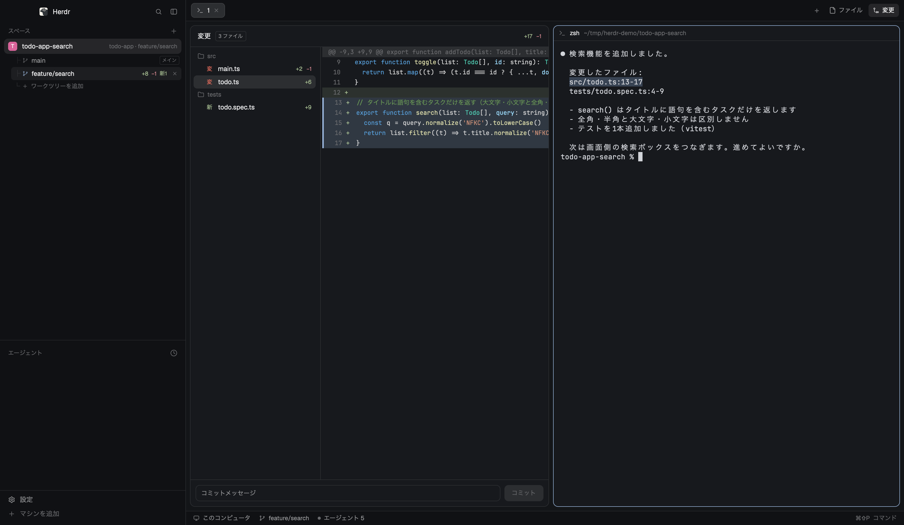

# herdr-ja

English | [日本語](README.ja.md)

A Japanese layout for [herdr-app](https://herdr.dev) built around git worktrees.
- Every label, menu, dialog and toast is in Japanese.
- Each space lists its repo's worktrees.
- Clicking a worktree turns the changed files and code into the main view, with the agent's terminal on the right.
- Selecting a `path:line` reference in any terminal jumps the code view to that line.



## What's inside

- `layouts/ja.json`: the layout, cloned from the shipped `main`. Besides the original right panel, it adds a `wt-panel` column (files / changes) that opens to the left of the terminals.
- `mods/`: seventeen `ja-*` mods, all clones of the shipped mods.
  - `ja-spaces`: the spaces list. Under the focused space it lists that repo's worktrees: branch, メイン badge, uncommitted `+add −del 新N`, `×` to remove, and 「ワークツリーを追加」. Clicking a worktree opens the wide files / changes view.
  - `ja-changes`: uncommitted changes, grouped under folder headings with file names beneath. The diff is syntax-colored, scrolls horizontally with the line numbers pinned, and highlights a referenced range.
  - `ja-files`: the file tree with `+add −del` per file. Its search bar has a ファイル名 (fuzzy) or 内容 (ripgrep) toggle, plus Aa / ab / .* for case, whole word and regex.
  - `ja-worktree`: the new/open worktree dialog. It opens worktrees as tabs in the current space and closes only the tabs inside a removed worktree.
  - `ja-tabs`: the tab bar, with ファイル / 変更 buttons that switch the worktree view when it is open.
  - `ja-agents`, `ja-pane`, `ja-workspace-chrome`, `ja-workspace-status`, `ja-menu`, `ja-new-menu`, `ja-picker`, `ja-help`, `ja-machine-add`, `ja-toast`: translated versions of the shipped mods.
  - `ja-prompt`, `ja-confirm`: the rename and close dialogs, which `ja-menu` and `ja-tabs` route to.
- `keys.json`: shortcuts scoped to the `ja` layout. F2 renames the tab, Shift+F2 renames the space, `cmd-w` closes the tab, `cmd-p` opens the picker, `cmd-/` opens help.

## Requirements

- herdr-app 0.1.16. The `ja-*` mods are clones of that version's shipped mods, so a newer herdr-app may need its changes merged in.
- [ripgrep](https://github.com/BurntSushi/ripgrep) (`brew install ripgrep`) for file search. Without it, filename search falls back to `git ls-files`, and content search does not work.
- `git`.

## Install

Ask your coding agent to install it:

```text
Read ~/.config/herdr-app/AGENTS.md, then add this layout: https://github.com/shimaMatz/herdr-ja
```

The agent copies `layouts/ja.json` and `mods/ja-*` into `~/.config/herdr-app/`, merges `keys.json`, checks each mod, and switches to the `ja` layout. `ctrl-shift-l` switches back to your previous layout.

## Update

Ask your coding agent:

```text
Read ~/.config/herdr-app/AGENTS.md, then update the herdr-ja layout from https://github.com/shimaMatz/herdr-ja
```

Or do it by hand. Copying over the installed files replaces any local edits to `layouts/ja.json` and `mods/ja-*`, so save those first.

```sh
cd ~/Develop/herdr-ja && git pull   # first time: git clone https://github.com/shimaMatz/herdr-ja.git ~/Develop/herdr-ja
cp layouts/ja.json ~/.config/herdr-app/layouts/
cp -R mods/ja-* ~/.config/herdr-app/mods/
cd ~/.config/herdr-app && for m in mods/ja-*; do herdr-app check $m; done
```

Mods reload live, so there is no need to restart the app. If `keys.json` in the repo changed, merge its `"layout:ja"` section into `~/.config/herdr-app/keys.json` by hand.

## Usage

- **Open a worktree:** click its row under the space. Files become the main view and the terminal moves to the right. Clicking a space row opens the same view for that space. Use the ファイル / 変更 buttons at the top right to switch views; pressing the active one closes the view.
- **Jump to code:** select `src/todo.ts:13-17` (or `path:line`, or just a path) in any terminal, for example in an agent's reply, by double-click or drag.
  - If the changes view is open and the file has changes, the diff scrolls there and highlights the lines.
  - Otherwise the files view opens the file at that line.
- **Scroll a long diff line:** swipe sideways on the trackpad, Shift + mouse wheel, or drag the thin bar under the diff.
- **Search files:** type in the bar above the file tree. Switch between ファイル名 and 内容, and toggle Aa / ab / .*.
- **Read and edit files:** code opens in a syntax-colored editor you can type in. Save with `cmd-s` or the header's 「● 保存」 button; opening another file saves unsaved edits first. A file changed elsewhere since you opened it is not overwritten; you get a notice instead. Files on another machine, and files too large to load whole, are read-only.
- **Copy:** select text in the code view or in the Markdown preview and press `cmd-c`. Markdown renders as a preview with its images; switch to コード to edit it.
- **Fold changes:** click a folder heading in the changes list to fold it. A folded heading shows its file count and `+add −del`.
- **Right-click a file or folder:** copy its relative or absolute path. In the file tree you can also create a file or folder, rename, or delete (on the local Mac, delete moves to the Trash).

## Privacy

- `ja-spaces`, `ja-changes`, `ja-files`, `ja-menu` and `ja-worktree` run `git` (status, diff numstat, ls-files, worktree) in the focused space's folder. `ja-changes` and `ja-files` count lines of new files with `wc`.
- `ja-files` runs `rg` in the focused folder when you search.
- `ja-spaces`, `ja-picker` and `ja-machine-add` call `hc` (herdr-core) to list machines.
- `ja-changes` and `ja-files` check every terminal's selection every 0.4 seconds. When a new selection appears, they read the clipboard once to parse a `path:line`. They write to the clipboard only when you choose a copy-path menu item.
- `ja-files` creates, renames and deletes files only from its right-click menu, after you confirm. To show images in a preview it copies them into `~/.config/herdr-app/data/ja-files/preview/` and removes copies older than a day.

Nothing reaches the network.

## Known limits

- herdr-app gives mods no event for clicking a link in a terminal. The jump works by watching the selection plus the clipboard, so it needs `copy_on_select` (on by default). Clicking a link without selecting it does nothing.
- A file that isn't in the current changes list, or a line outside the shown hunks, is opened in the files view instead.
- A folder with no repo shows no changes list. Very large untracked folders (such as a home directory) take a while to load the first time.
- Only the mods' own menus and dialogs are translated. App frames (settings, the command palette `cmd-shift-p`, welcome, update notices) stay in English.

## Design notes

See [RECIPE.md](RECIPE.md) for the full spec: the layout tree, how each mod behaves, and the pitfalls found while building it.
