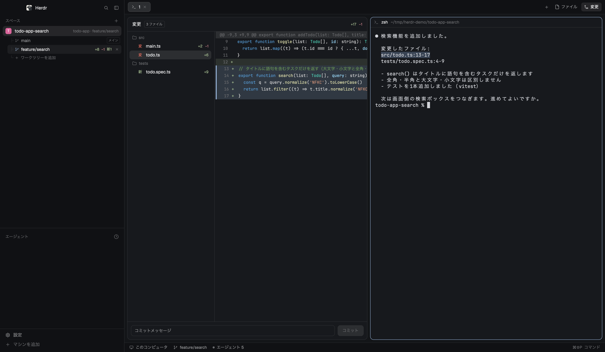

# Herdr ja

A Japanese-language Herdr window for working with coding agents across git worktrees. Every visible label, menu, dialog and toast is in Japanese. Each space lists its repo's worktrees underneath it. Clicking a worktree turns the files/changes view into the main area, with the agent's terminal moved to the right. Selecting a `path:line` reference in any terminal jumps the code view to that line.

## What you see

Left to right:

- **Sidebar** (`sidebar`, min 44px), top to bottom:
  - The brand row (`ja-workspace-chrome`).
  - The spaces list (`ja-spaces`). Under the focused space it lists that space's worktrees. Each worktree row shows its branch, a メイン badge for the main checkout, uncommitted `+add −del 新N` counts in green, red and dim, and an `×` to remove it. The last row is 「＋ ワークツリーを追加」.
  - The agents list (`ja-agents`), grouped as 作業中 / 待機中 / etc.
  - The footer, with 設定 and マシンを追加.
- **Work column**, top to bottom:
  - The tab strip (`ja-tabs`). On its right sit the ファイル and 変更 buttons.
  - `work-body`, a row:
    - **`wt-panel`** (hidden until a worktree is clicked, weight 3, min 400). It is a stack of `wt-files` and `wt-changes` with `props.wide`: a list on the left, a draggable splitter, and the code or diff on the right.
    - **`main`**, the tab's panes (min 360).
    - **`panel`**: the original right panel (368px, `files` and `changes` stacked). It is used when no worktree view is open.
  - The status bar (`ja-workspace-status`).

The changes view groups files under folder headings. Each heading has a folder icon and the dim directory. File names are indented beneath it, with 新 / 削 / 競 / 変 status and `+add −del`. The diff is syntax-colored and scrolls horizontally while the line-number and +/− columns (64px) stay pinned on the left. Width is computed with full-width characters counting as 2 columns.

The files view has a search bar above the tree. A ファイル名 / 内容 toggle switches between filename and content search, and Aa / ab / .* toggle case, whole word and regex. The tree shows `+add −del` per file versus HEAD.

## How it behaves

- **Click a worktree row:** hides `panel`, selects `wt-files` in `wt-panel-body`, and shows `wt-panel`. It then focuses the space's tab already working inside that worktree, or opens a new tab there.
- **Click a space row:** hides `wt-panel` and selects the space.
- **ファイル / 変更 buttons:** switch `wt-panel` when it is open, otherwise the normal right panel.
- **New or open worktree:** opens it as a tab in the current space, not as a new space.
- **Remove a worktree:** closes only the tabs inside it. If every tab is inside it, the whole space closes.
- **Jump to code:** when text is selected in any terminal, a 0.4s poll of `terminals()[i].selection` notices it. With `copy_on_select`, the text is already on the clipboard; after 350ms it is read and parsed as `path[:line[-end]]`.
  - If the changes view is shown and the file is changed, the diff scrolls to the line and highlights the range (accent background plus a left border).
  - Otherwise the reference is handed to the files view through `setShared("ja-jump", {path, line, end, at})`. The files view opens the file and centers the range by setting a selection 12 lines below first, then the target 80ms later.
- **File search:**
  - ファイル名 mode lists files with `rg --files --hidden -g !.git -g !node_modules`, falling back to `git ls-files -co --exclude-standard`. Results are ranked: name prefix, then name contains, then path contains, then fuzzy. It is debounced 120ms and shows the top 300.
  - 内容 mode runs `rg --null --line-number …` with the toggles, debounced 300ms. It shows at most 2000 hits, grouped by file, with matches highlighted. Clicking a hit opens the file at that line.
- **Rename and close dialogs** go through `ja-prompt` / `ja-confirm`.
- **Keys** (`keys.json`, section `layout:ja`): F2 renames the tab, Shift+F2 renames the space, ⌘W closes the tab, ⌘P opens the picker, ⌘/ opens help.
- **Loading:** files and changes skip refreshing while hidden. Changes restarts loading when the focused folder changes. A home folder with no repo shows no change list.

## Built from

- `layouts/ja.json`: a clone of shipped `main` (0.1.15) whose blocks point at the `ja-*` clones, plus the `wt-panel` column described above.
- `mods/ja-*`: clones of the shipped mods (agents, changes, confirm, files, help, machine-add, menu, new-menu, pane, picker, prompt, spaces, tabs, toast, workspace-chrome, workspace-status, worktree), translated and extended.
- Uses from `herdr`: `run("layout.show" | "layout.hide" | "layout.select" | "space.select" | "tab.select" | …)`, `terminals()`, `panes()`, `shared` / `setShared`, `exec`, `readTextFile`.
- Uses from `gpui-base`: `v_virtual_list` + `VirtualListScrollHandle`, `EditorState`, `InputState` / `Input`, `Scrollbar`.
- Programs it runs: `git` (status, numstat, worktree), `rg` (ripgrep, for file search), and `hc` (ja-tabs, ja-prompt). It does not reach the network.

## Watch out

- Herdr gives mods no event for clicking a link in a terminal. The jump works only by polling the selection plus the clipboard, so it needs `copy_on_select` (on by default). It overwrites nothing; it only reads the clipboard.
- Mods are not re-rendered when a terminal selection changes, so the 0.4s timer is required. `focused()` covers only the focused terminal, so scan `terminals()`.
- Setting two selections in the same frame does not center the editor. Await a short sleep between them.
- Counting characters underestimates the width of CJK lines; count full-width characters as 2.
- `overflow_x_scroll` would move the line numbers too. Horizontal scroll is done by hand instead: `on_scroll_wheel` (horizontal delta, or Shift + vertical) changes `dx`. Each row's code sits in an `overflow_hidden` box at `left(-dx)`. A thin custom thumb at the bottom can be dragged. `on_size_change` on the diff element gives the viewport width. `dx` resets when another file opens.
- Install ripgrep (`brew install ripgrep`). Without it, ファイル名 search falls back to git, and 内容 search does not work.
- Built against Herdr 0.1.16. Shipped mods change between versions; if a mod fails `herdr-app check`, rebuild that piece from this recipe.
